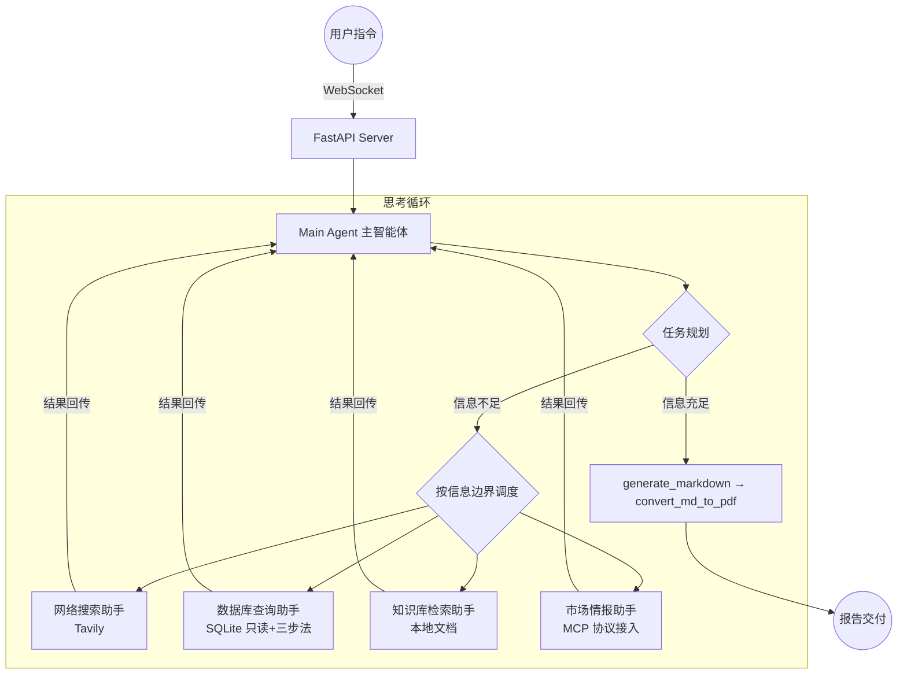

# market-research-agent

**行业竞品调研多智能体系统** —— 基于 DeepAgents 的「1 主 + 4 专」架构，融合 MCP 协议、可回归评测与防失控设计，输入一句调研问题，产出结合内部数据与外部情报的分析报告。


## 它解决什么问题

传统 RAG 是"单次检索 + 一次回答"，面对「调研竞品格局，结合我们的销售数据」这类复合任务时：信息源分散（公开网络 / 内部数据库 / 内部文档 / 外部情报服务）、需要多轮规划与交叉验证、最终要交付结构化文档。

本项目的答案是：**主智能体做项目经理，四个专家子智能体按信息边界并行取数，主智能体汇总后生成 Markdown/PDF 报告**——整个过程实时可视化，且可量化评测。

## 架构



## 核心特性

- **1 主 + 4 专**：主智能体只做规划/调度/交付，不直接取数；子智能体按信息边界切分，提示词配置化（`prompt/prompts.yaml`）
- **MCP 协议接入**：`mcp_server/` 自研市场情报 MCP Server（stdio），Agent 侧通过 `langchain-mcp-adapters` 动态发现工具——情报源与 Agent 完全解耦，换真实舆情 API 时 Agent 零改动
- **防失控设计**：
  - SQL 双重只读防护：工具层白名单拦截（含 CTE 夹带写操作检测）+ SQLite `mode=ro` 连接级兜底
  - 路径安全解析：清洗 LLM 幻觉路径（`/workspace`、`/mnt/data`），会话目录防嵌套、防越权
  - 提示词硬约束：检索上限、先查表结构再写 SQL、信息不齐禁止生成占位符文件
- **可回归评测**：每次任务落盘工具调用轨迹（JSONL），`eval/` 从轨迹计算维度覆盖率/任务完成度/效率分，一条命令出评测报告
- **双模式运行**：配置 LLM Key 走真实推理；`MOCK_LLM=1` 预置决策轨迹但**工具调用全部真实执行**（查库/检索/MCP 都是真实数据），无 Key 可完整体验
- **工程化**：pytest 单测 + GitHub Actions CI + 产物下载越权校验 + PDF 跨平台降级（无 Word 环境输出打印版 HTML）

## 快速开始

```bash
# 1. 安装依赖（Python 3.11+）
pip install -r requirements.txt

# 2. 配置环境变量
cp .env.example .env
#    编辑 .env：填入 DASHSCOPE_API_KEY（通义千问）或 DeepSeek Key
#    可选：TAVILY_API_KEY（联网搜索，https://app.tavily.com 免费 1000 次/月）

# 3. 初始化演示数据库
python data/init_demo_db.py

# 4a. 无 Key？先体验演示模式（决策轨迹预置，工具调用真实执行）
python main.py demo

# 4b. 有 Key？启动 Web 服务
python main.py server      # 浏览器打开 http://localhost:8000

# 4c. 命令行模式
python main.py cli "对比我们和声浪科技的销售差距，分析原因并给出建议"
```

### 跑评测

```bash
python main.py eval        # 跑 eval/eval_set.jsonl，输出 output/eval/eval_report.md
```

评测集每行一个用例：`{"id", "query", "expected_dimensions", "expect_file"}`。
调整提示词或更换模型后重跑，对比 `info_coverage / score` 是否退化——这是 Agent 项目的回归测试。

## 项目结构

```
market-research-agent/
├── agent/
│   ├── main_agent.py          # 主智能体组装 + 流式执行 + 轨迹记录
│   ├── mock_runtime.py        # 演示模式运行时（无 Key 体验）
│   ├── llm.py / load_prompt.py
│   └── sub_agents/            # 网络搜索 / 数据库 / 知识库 / MCP 四个子智能体
├── api/
│   ├── server.py              # FastAPI + WebSocket + 上传下载（越权校验）
│   ├── monitor.py             # 工具执行监控 → WebSocket 定向推送
│   └── context.py             # ContextVars 协程级会话隔离
├── tools/                     # Tavily / SQLite(只读) / 文档检索 / MD / PDF
├── mcp_server/
│   └── market_mcp_server.py   # 自研 MCP Server（FastMCP，stdio）
├── eval/                      # 评测集 + 轨迹记录 + 指标 + 回归入口
├── prompt/prompts.yaml        # 提示词统一配置
├── data/                      # 演示库初始化脚本 + 内部知识库文档
├── web/index.html             # 单文件前端（WebSocket 过程可视化）
└── tests/                     # 路径安全 / SQL 拦截 / 评测指标 单测
```

## 设计决策（Why）

| 决策 | 原因 |
|---|---|
| MySQL → SQLite + SQLAlchemy 风格工具层 | 数据库依赖是复现的最大门槛；SQLite 让仓库克隆后 3 条命令跑通，工具层保留 Text-to-SQL 三步法设计 |
| 自研 MCP Server 而非直连 API | MCP 是工具与 Agent 的协议边界：情报服务独立演进，Agent 零改动；同时动态工具发现是 Agent 架构能力的直接展示 |
| ContextVars 而非全局变量/threading.local | asyncio 并发跑在同一线程，全局变量"串台"；ContextVar 协程级隔离，深层工具函数都能拿到当前会话上下文 |
| PDF 用 Word COM + HTML 降级 | weasyprint 在 Windows 依赖 GTK 安装失败率高；Word COM 排版最好，其他平台 HTML 保底，转换永不阻塞任务 |
| 评测基于工具调用轨迹而非最终文本 | 文本质量难量化且不稳定；轨迹指标（覆盖率/完成度/效率）确定可回归，且能暴露"哪个信息维度没被使用"这类结构性问题 |

## Roadmap

- [ ] RAGFlow 子智能体（企业私有知识库，替换本地检索）
- [ ] 评测加入最终报告的 LLM-as-Judge 打分，与轨迹指标加权
- [ ] 多会话并行压测与 token 成本统计
- [ ] Docker Compose 一键部署

## License

MIT
